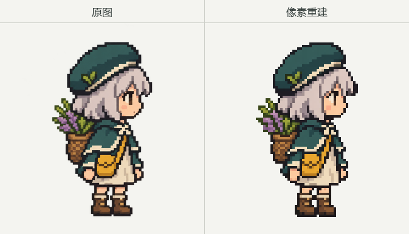
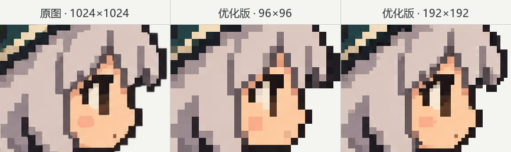
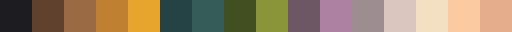
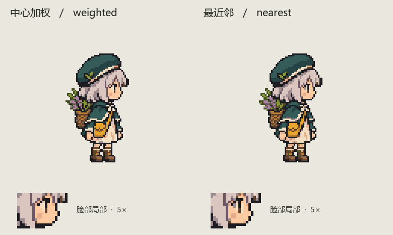

# True Pixel · 真像素重建

True Pixel 把放大过的像素画或 AI 生成的像素风图片，重建成可以直接用在游戏里的小尺寸透明 PNG。你可以指定角色的宽高、保留半透明边缘，或让所有可见像素只使用项目色板中的颜色。转换在本机完成，需要 Python 3.10+、Pillow 和 NumPy。

## 示例 · 银发药剂师

这位药剂师来自 `godot-lab` 实验 001。两种尺寸共用一张从原图选出的 **16 色色板**。左边是 1024×1024 原图，中间是 96×96 精灵，右边是 192×192 精灵，三列等大显示。



**脸部细节。** 96 版用一格墨色补回眼线，一格暖肤色保留嘴点。192 版有更多像素描出眼形。两份 PNG 都实际用齐了 16 种可见 RGB 颜色，透明背景另计，边缘采用二值透明。



[下载 96×96 精灵](examples/herbalist/refined.png) · [下载 192×192 精灵](examples/herbalist/refined-192.png) · [查看原图](examples/herbalist/input.png)

**共用色板**为帽子和披风保留两级青绿，也为背篓里的绿叶和紫花分别留了色位。复用时，把下面的 PNG 传给 `--palette` 即可。[下载 16 色色板](examples/herbalist/palette-16.png)



### 同尺寸对比采样算法

左图使用默认的中心加权投票，右图使用最近邻。两版均从同一张原图生成 96×96 精灵，使用相同的 16 色色板和二值透明，省略细节点修正。两版有 111 个像素不同，其中 6 个位置的透明状态不同。下方放大了同一处眼部细节。



[中心加权原生 PNG](examples/herbalist/sampling-weighted.png) · [最近邻原生 PNG](examples/herbalist/sampling-nearest.png)

```sh
python skills/true-pixel/scripts/true_pixel.py examples/herbalist/input.png out/weighted --size 96x96 --sampling weighted --alpha binary --palette examples/herbalist/palette-16.png
python skills/true-pixel/scripts/true_pixel.py examples/herbalist/input.png out/nearest --size 96x96 --sampling nearest --alpha binary --palette examples/herbalist/palette-16.png
```

### 复现实验 001 的角色裁切

要保留实验 001 静态采药师的嘴点和发梢，用二值透明去除低透明度边缘，按主体包围框缩放，再放回游戏画布。

```sh
python skills/true-pixel/scripts/true_pixel.py examples/herbalist/input.png out/herbalist-framed --size 96x96 --sprite-height 64 --bottom-margin 12 --sampling nearest --alpha binary
```

这张图裁出 438×766 的主体，缩为 37×64，左上角放在目标画布的 `(30, 20)`。输出保留原色，与实验静态精灵逐像素一致。[查看 96×96 成品](examples/herbalist/framed-96.png)

## 安装为 AI 技能

把下面这句话发给支持安装 Agent Skills 的 AI 助手即可。

> 请从 https://github.com/YiTongHu-SC/true-pixel/tree/main/skills/true-pixel 安装并启用 true-pixel 技能，在运行该技能的 Python 环境中安装 requirements.txt 里的依赖。

**手动安装**也可以。克隆仓库，将整个 `skills/true-pixel` 目录复制到助手的技能目录。例如 Codex 的用户级路径是 `~/.agents/skills/true-pixel/`，复制后应能直接看到其中的 `SKILL.md`。在技能目录运行 `python -m pip install -r requirements.txt`，然后新开一个会话。

安装后可以直接说：“用 true-pixel 把这张角色图重建为 96×96，背景透明，颜色限制在我附上的色板里。给我原生 PNG 和放大预览。”

## 在命令行复现示例

在已激活的 Python 3.10+ 虚拟环境中运行：

```sh
git clone https://github.com/YiTongHu-SC/true-pixel.git
cd true-pixel
python -m pip install -r skills/true-pixel/requirements.txt
python skills/true-pixel/scripts/true_pixel.py examples/herbalist/input.png out/herbalist-96 --size 96x96 --alpha binary --detail-point 53,37 --detail-point 58,42 --palette examples/herbalist/palette-16.png
python skills/true-pixel/scripts/true_pixel.py examples/herbalist/input.png out/herbalist-192 --size 192x192 --alpha binary --detail-point 110,71 --detail-point 116,85 --palette examples/herbalist/palette-16.png
```

两个输出目录各含一份原生尺寸的 `native.png` 和一份放大后的 `preview.png`。细节点坐标按各自的目标画布选取。保留 `--palette` 并省略两处 `--detail-point`，可对照同色板下的默认采样效果，每次运行使用新的输出目录。

## 选择尺寸、边缘和色板

| 需求 | 参数 | 处理方式 |
| --- | --- | --- |
| 选择采样算法 | `--sampling weighted` 或 `--sampling nearest` | 默认按格内中心权重和透明度投票取色。最近邻复制中心附近单个源像素的 RGBA。两种算法都支持指定尺寸和自动网格。 |
| 从放大图恢复原尺寸 | 省略 `--size` | 分别估计横纵网格的间距和起点。适合全图使用统一、水平和垂直像素网格的静态图。 |
| 按游戏规格制作精灵 | `--size 32x48` | 按指定宽高分格取色。支持非方形画布和非整数缩放比例，目标宽高须在处理后画布的像素尺寸以内。 |
| 原图和目标比例不同 | `--fit pad` 或 `--fit crop` | 搭配 `--size` 使用。前者居中补透明边并保留全图，后者居中裁切以填满目标。 |
| 按角色高度排入画布 | `--sprite-height 64 --bottom-margin 12` | 用 `--size` 指定输出画布。按可见主体等比缩放，水平居中，底部默认留 0 行。默认用 Alpha > 0 定位主体，`--alpha binary` 时先按 128 二值化。网格图显示裁出的采样区域，细节点坐标以最终画布为准。 |
| 保留半透明或制作硬边 | `--alpha preserve` 或 `--alpha binary` | 默认保留透明度。选 `binary` 时，Alpha 小于 128 的像素全透明，其余全不透明。 |
| 保留缩小后消失的细线或小点 | `--detail-point X,Y` | 指定一个输出格，左上角为 `0,0`，可重复使用。搭配 `--size`，在该格附近试最多九个采样位置，并比较按覆盖率取色的候选。 |
| 统一到固定色值 | `--palette palette.png` | 色板 PNG 可由 1–256 种不同的可见 RGB 颜色组成。每个可见输出像素映射到 RGB 距离最近的色板值，无抖动。透明度单独处理。 |

## 判断结果

| 退出码 | 含义 | 接下来怎么做 |
| --- | --- | --- |
| `0` | 已生成 `native.png` | 使用原生 PNG，用 `preview.png` 查看整数倍放大效果。 |
| `2` | 自动网格需要复核 | 查看 `grid.png` 和 `report.json` 中的 `issues`。两轴都有候选时，可查看 `candidate.png` 和预览。知道目标尺寸时，用 `--size` 重新运行。 |
| `1` | 输入或输出处理失败 | 按终端错误检查图片、色板、宽高比和输出目录。 |

AI 助手可读取[技能入口](skills/true-pixel/SKILL.md)获取调用约定。另有[提灯示例](examples/lantern)，可对照同一张图在 32×32 和 48×48 下的高光差异。仓库根目录运行 `python -m unittest discover -s tests -v` 可执行回归测试。
